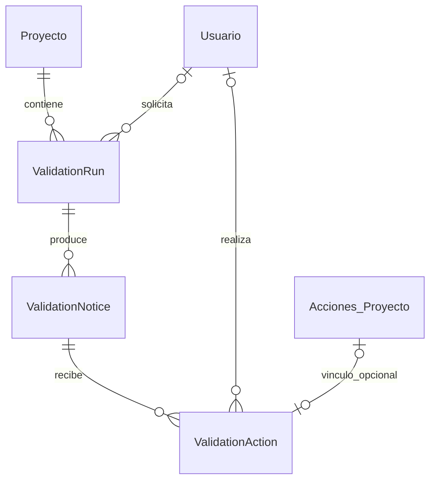

# Arquitectura y estándar de código · Sprint 1

## Estándar utilizado

TypeScript estricto, componentes funcionales React y React Hooks; ESLint con las reglas existentes `typescript-eslint`, React Hooks y React Refresh para todo el código nuevo de validación. Nombres en inglés para símbolos de código y español para interfaz/documentación. Indentación de dos espacios en TypeScript/TSX, comillas simples y punto y coma. CSS legible, separado y con prefijo `validation-`. No se añade una dependencia de formato ni se reformatea la aplicación completa.

Se aplica separación de responsabilidades: contratos/validación de entrada, proveedor mock, presentación y resaltado DOM. Las funciones de contrato son puras; los efectos de React tienen limpieza; no se usa `any`, HTML crudo ni texto del LLM como código en el módulo nuevo. El adaptador JointJS usa conversiones estrechas porque sus tipos Backbone son incompletos en este repositorio.

## Componentes y flujo

`ConnectedDiagramPage` entrega rol, proyecto y contexto del lienzo a `ValidationWorkspace`. Al abrir, se capturan referencias a los objetos actuales; `mockNoticeProvider` crea ejemplos tipados. `NoticeList`, `NoticeDetail` y `PanelStatus` presentan la información. `highlightViews` modifica exclusivamente clases CSS en el DOM, no atributos del modelo JointJS.

La identidad de objeto se compara al seleccionar: un import/reset que reutilice `displayId` no debe resaltar otra clase por accidente. Las referencias desaparecidas se muestran como no localizables. Atributos se localizan por su clase contenedora; no se promete selección individual de una fila interna.

Los ejemplos no se almacenan, no abren llamadas LLM y no ejecutan análisis. El selector de escenarios es visible como demostración. El panel es accesible para creador/editor/vista; rol desconocido no habilita acceso. Cambiar el rol mientras está abierto oculta resultados. No hay endpoints nuevos de datos sensibles.

Se retiraron del editor los bloques antiguos de recomendaciones de atributos, clases y relaciones, sus acciones y llamadas. Se conservan el chatbot de ayuda y los asistentes de texto/audio/imagen, que tienen otra función.

## Diseño ORM

### Diccionario

| Modelo | Datos | Restricciones/índices |
|---|---|---|
| ValidationRun | ID cuid, proyecto, solicitante opcional, snapshotHash, catalogVersion, modelVersion opcional, estado y fechas. | Único proyecto+hash+versión de catálogo; índice proyecto+fecha. La versión de catálogo deberá representar toda configuración que cambie el resultado, incluido modelo cuando corresponda. |
| ValidationNotice | ID, ejecución, fingerprint, código, severidad, origen, estado, resumen, explicación, recomendación, referencias JSON y fechas. | Único ejecución+fingerprint; índice ejecución+severidad. |
| ValidationAction | ID, aviso, actor opcional, vínculo de auditoría opcional, clave idempotente, acción, hash y fecha. | Clave idempotente única; auditActionId único; índice aviso+fecha. |

Fuente única del diagrama: `Proyecto.diagrama_json`. No se agregan tablas de clases, multiplicidades, atributos o relaciones UML. `affected` almacena referencias del resultado, no el dominio completo; no tiene FK a clases dentro del JSON. Su forma y pertenencia al proyecto se validarán en el servicio futuro, no se presupone que PostgreSQL conoce el grafo UML.

Una recomendación textual pertenece al aviso y no requiere otra tabla. Las acciones tipadas son la fuente de verdad de decisiones del módulo. El vínculo opcional a `Acciones_Proyecto` permite reutilizar un evento existente, pero no obliga a escribir una segunda fila por decisión. En Sprint 1 no se crean registros de negocio reales desde el panel.

`ACCEPTED`/`REJECTED` son decisiones; `APPLIED`/`APPLICATION_FAILED` son resultados de aplicación. No hay cambio automático de estado del aviso por aceptar. La resolución se verifica en análisis posteriores. Antes de los servicios futuros se definirá qué respuesta reabre un rechazo y cómo imponer consistencia de revisiones y permisos en una transacción.

### Identidad, borrado y retención

La base referencia proyecto/usuario existentes. Clases del JSON no tienen una identidad histórica garantizada: `displayId` puede normalizarse; por eso se exige hash/captura y referencias dentro de ella. No se crea otro sistema de guardado del diagrama en este sprint.

Borrar proyecto elimina sus ejecuciones, avisos y acciones. Borrar usuario conserva resultados/acciones anonimizando solicitante/actor; borrar auditoría elimina solo el vínculo opcional, no la acción especializada. Esta política no inventa nombres personales para usuarios eliminados. La retención temporal/archivo requiere acuerdo antes del uso de producción; no hay purga automática.

### Migración

`20261021000100_validation_audit` crea cinco enums y tres tablas; solo añade relaciones inversas en Prisma a las entidades existentes. No elimina ni modifica columnas de `Proyecto` ni su JSON. No se aplica a producción en este trabajo.

En una base desechable, ejecutar `prisma migrate deploy`, `prisma validate` y `prisma generate`; ejecutar las pruebas ORM con `VALIDATION_TEST_DATABASE_URL`. La prueba contiene una guarda que solo acepta localhost y nombre `sprint01_*`. Los datos temporales se identifican y limpian al finalizar.

## Comandos de verificación

Desde `backendia`: `node node_modules/prisma/build/index.js validate`, `node node_modules/prisma/build/index.js generate`, `npm run build` y `node node_modules/tsx/dist/cli.mjs --test tests/validation-audit.test.ts` con la variable de prueba.

Desde la raíz: `node backendia/node_modules/tsx/dist/cli.mjs --test diagramadoria/tests/validation-contracts.test.ts`.

Desde `diagramadoria`: `npm run build` y `node node_modules/eslint/bin/eslint.js src/features/validation`.

Navegador: iniciar Vite local y ejecutar `node diagramadoria/tests/validation-ui.mjs`. Playwright debe estar instalado en el entorno de pruebas; opcionalmente indicar su módulo en `PLAYWRIGHT_MODULE`. `VALIDATION_UI_URL` permite seleccionar el puerto local. La prueba usa el editor/JointJS reales con respuestas HTTP de proyecto interceptadas y no escribe sobre proyectos reales.

Regresión adicional: compilar backend y ejecutar `node --test tests/project-regression.test.mjs` con `VALIDATION_TEST_DATABASE_URL` local. Inicia un backend hijo en 55492, prueba API y tres clientes Socket.IO reales y lo detiene al terminar. Usa `socket.io-client` de la instalación frontend del mismo repositorio. No apunta al backend real del usuario.
