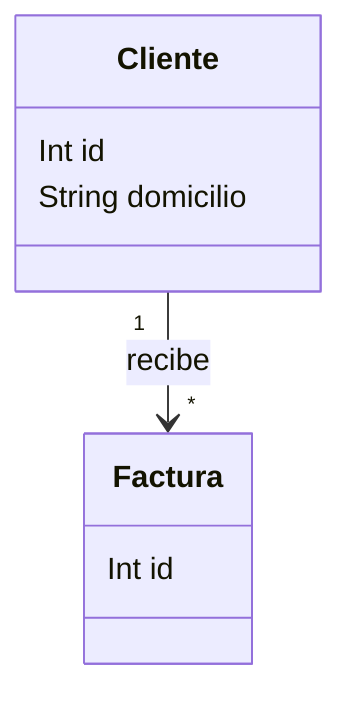

# Informe Scrum del Sprint 1
## Modelo de datos, auditoría y panel de avisos UML

**Proyecto:** Diagramador Inteligente  
**Módulo:** Agente Inteligente para la Validación de Diagramas de Clases en Tiempo Real  
**Fecha de elaboración del informe:** 23 de octubre de 2026  
**Entrega técnica documentada:** 21 de octubre de 2026  
**Estado:** implementación técnica disponible y verificada; revisión funcional y aceptación pendientes.

## 1. Propósito y fuentes

Este informe reúne lo planificado, los cambios de alcance autorizados, las historias desarrolladas, la solución construida y las evidencias del Sprint 1. Es una memoria del trabajo realizado, no un plan de desarrollo futuro ni un acta de aceptación ya firmada.

Fuentes internas:

- [Definición del módulo](modulo_agente_validacion_uml.md).
- [Contexto y criterios del Sprint 1](contexto_sprint_01.md).
- [Informe de entrega técnica](docs/sprint-01/informe-entrega.md).
- [Arquitectura y estándar de código](docs/sprint-01/arquitectura-y-estandar.md).
- [Catálogo de reglas](docs/sprint-01/catalogo-reglas.md).
- [Evidencias y huellas de archivos](docs/sprint-01/evidence/source-sha256.json).

La organización del informe toma como referencia la [Guía Scrum 2020 oficial](https://scrumguides.org/scrum-guide.html): objetivo, backlog, incremento e inspección del resultado. La revisión sirve para inspeccionar y adaptar; no se reduce a una demostración ni constituye una autorización obligatoria de despliegue. Los puntos de historia y este formato de informe son herramientas del proyecto, no requisitos de Scrum.

Los resultados aquí descritos proceden de los archivos y registros existentes. En la elaboración de este informe no se volvieron a ejecutar las pruebas ni se modificó código.

## 2. Objetivo del Sprint

**Implementar el modelo de persistencia de resultados y acciones del módulo mediante Prisma y desarrollar el panel integrado al editor con datos de ejemplo de estructura contractual definida, para preparar la trazabilidad de la validación y permitir que el usuario consulte, interprete y localice avisos antes de incorporar los motores reales.**

El valor del incremento es doble: disponer de una interfaz que se puede utilizar y revisar en el editor, y contar con una estructura de almacenamiento comprobada para los resultados y decisiones que posteriormente producirá el agente.

### Relación con los objetivos del módulo

| Objetivo del módulo | Contribución del Sprint 1 |
|---|---|
| Analizar requisitos y reglas para elaborar backlog y catálogo. | Se concretaron siete historias, criterios verificables, contratos y catálogo con excepciones y límites. |
| Diseñar el panel y la trazabilidad sin duplicar información. | Se construyeron componentes del panel y tres modelos Prisma vinculados a entidades existentes. |

No se atribuye a este sprint el cumplimiento de los objetivos de detección automática, grafos o análisis semántico.

## 3. Acuerdos y evolución del alcance

La planificación se ajustó mediante las aclaraciones del responsable del proyecto:

| Aclaración | Efecto sobre el trabajo |
|---|---|
| El nuevo archivo del módulo pasa a ser la referencia principal. | Se sustituyó el planteamiento anterior de entregar reglas reales en Sprint 1 por un incremento de interfaz con ejemplos. |
| Se permite trabajar con mocks o datos estáticos. | El panel se desarrolló contra un proveedor separado, sin simular que el motor ya existe. |
| HU-01 puede implementarse mediante el ORM. | Se amplió el diseño de datos a modelos Prisma, migración y pruebas reales de almacenamiento en PostgreSQL aislado. |
| El proyecto y el diagrama ya se guardan. | Se reutiliza `Proyecto.diagrama_json`; no se crea otro sistema de persistencia del modelo UML. |
| Las recomendaciones antiguas se reemplazan. | Se retiraron del editor sus paneles, acciones y llamadas de recomendaciones de clases, atributos y relaciones. |
| Se solicita código limpio y componentes. | Se separaron contratos, mocks, componentes, resaltado y estilos, con TypeScript estricto y ESLint. |

La ampliación ORM modifica el trabajo previsto de HU-01. Sus cinco puntos originales y el total inicial de 22 PHU no se reestimaron de forma confirmada; no se presentan como esfuerzo real consumido.

## 4. Alcance efectivamente desarrollado

| Submódulo | Entrega del Sprint 1 | Frontera |
|---|---|---|
| Validación estructural | Catálogo R01–R06 y contrato de avisos. | Sin motor de reglas ejecutable. |
| Análisis de grafo | Definición G01–G03, ejemplos y excepciones. | Sin BFS/DFS operativo. |
| Análisis semántico | Definición S01–S05 y ejemplos de presentación. | Sin conexión nueva a Claude ni análisis real mediante LLM. |
| Panel de avisos | Acceso, listado, detalle, estados y resaltado de elementos existentes. | Los resultados son ejemplos identificados; no son detecciones. |
| Auditoría y trazabilidad | Tres tablas del módulo, migración y comprobaciones ORM. | Sin endpoints ni interfaz operativa para aceptar, rechazar o consultar historial persistido. |

### Exclusiones expresas

- Tablas de clases UML, atributos, relaciones o multiplicidades.
- Copias completas del diagrama por cada aviso o acción.
- Análisis automático tras cambios y sincronización de nuevos avisos.
- Aceptación, rechazo o corrección desde el panel.
- Despliegue o migración sobre la base real del usuario o producción.

## 5. Sprint Backlog y resultado por historia

Los puntos siguientes son las estimaciones iniciales del documento de referencia. Los estados distinguen verificación técnica y aceptación del responsable.

| Historia | Prioridad | PHU iniciales | Entrega | Estado |
|---|---|---:|---|---|
| HU-01. Modelo de avisos y decisiones | Alta | 5 | Modelos Prisma, migración, contratos y diseño de auditoría. | Implementada y probada; políticas pendientes de aceptación. |
| HU-02. Acceso al panel | Alta | 3 | Control «Avisos UML» integrado al editor. | Implementada y verificada. |
| HU-03. Listado por severidad | Alta | 3 | Avisos ordenados, con severidad y origen. | Implementada y verificada. |
| HU-04. Detalle del aviso | Alta | 3 | Explicación, recomendación y referencias afectadas. | Implementada y verificada. |
| HU-05. Resaltado | Alta | 3 | Localización visual temporal en JointJS. | Implementada y verificada. |
| HU-06. Estados del panel | Media | 2 | Escenarios controlados de presentación. | Implementada y verificada. |
| HU-07. Catálogo y estándar | Alta | 3 | Reglas, límites y convenciones documentados. | Documentada; aprobación funcional pendiente. |
| **Total de referencia** | | **22** | No equivale a velocidad ni puntos aceptados. | Reestimación pendiente tras ampliar HU-01. |

### HU-01. Modelo de avisos y decisiones

**Necesidad:** conservar resultados y decisiones del módulo sin duplicar el proyecto ni su diagrama.

**Trabajo realizado:** se inspeccionó el esquema existente, se separaron ejecución, aviso y acción, se incorporaron restricciones de unicidad y claves foráneas y se generó la migración `20261021000100_validation_audit`.

**Resultado:** los modelos `ValidationRun`, `ValidationNotice` y `ValidationAction` almacenan información propia del módulo. La recomendación textual pertenece al aviso y no exige otra tabla. El vínculo opcional a `Acciones_Proyecto` permite relacionar una decisión especializada con la auditoría existente.

**Comprobación:** escritura/lectura, restricciones, rollback, conservación del diagrama, anonimización de referencias al borrar usuario y eliminación en cascada al borrar proyecto. Se verificó además la migración desde el esquema previo con un proyecto ya creado.

**Límite:** las tablas están preparadas y probadas; el panel todavía no guarda decisiones. Las referencias del JSON UML no son claves foráneas de PostgreSQL.

### HU-02. Acceder al panel

**Necesidad:** consultar avisos sin abandonar el diagrama.

**Trabajo realizado:** se incorporó `ValidationWorkspace` al editor, con apertura y cierre, identificación permanente de demostración y consulta para creador, editor y vista. Se reemplazó el acceso a recomendaciones antiguas.

**Comprobación:** apertura/cierre por botón y Escape, conservación de la exportación del diagrama y consulta en los tres roles. El panel no añade endpoints de acceso a datos privados.

### HU-03. Listar avisos ordenados

**Necesidad:** distinguir qué aviso revisar primero y de qué motor procedería.

**Trabajo realizado:** `NoticeList` presenta resumen, severidad y origen. Se ordena por error, advertencia y recomendación, con desempate por código e identificador. El proveedor de ejemplos está separado de los componentes.

**Comprobación:** pruebas de orden estable, contrato y rechazo de identificadores duplicados; navegador con tres avisos y tres orígenes. Ninguno se presenta como resultado de un motor real.

### HU-04. Consultar detalle

**Necesidad:** comprender el motivo del aviso y la alternativa propuesta.

**Trabajo realizado:** `NoticeDetail` presenta explicación, recomendación, referencias y captura de ejemplo. Cambiar de selección cambia el detalle. El texto se presenta mediante React, sin ejecutar HTML crudo ni instrucciones.

**Comprobación:** correspondencia entre aviso y detalle y ausencia de botones operativos de aceptar, rechazar o aplicar.

### HU-05. Resaltar elementos

**Necesidad:** ubicar las clases y relaciones mencionadas.

**Trabajo realizado:** `useNoticeHighlight` resuelve referencias y `highlightViews` aplica clases CSS temporales a la vista, sin modificar el modelo JointJS. Para atributos se resalta su clase contenedora. Los elementos inexistentes se indican en el detalle.

**Comprobación:** selección y limpieza del resaltado, rol vista, referencias ausentes y sustitución de captura mediante importación. Se comparó la exportación antes/después y se verificó que el panel no invoca el envío de actualizaciones del diagrama.

**Decisión técnica:** se compara identidad de objeto para no resaltar una clase nueva solo porque reutiliza un `displayId` anterior.

### HU-06. Mostrar estados

**Necesidad:** interpretar la disponibilidad y los límites de lo mostrado.

**Trabajo realizado:** `PanelStatus` diferencia avisos disponibles, analizando, vacío, parcial, fallo y sin permisos. Un selector permite explorar esos seis escenarios.

**Comprobación:** navegación por los estados, conservación del aviso de demostración y mensajes que no confunden fallo o ausencia de avisos con corrección total del diagrama.

**Límite:** son estados simulados de interfaz, no ejecución ni falla de un motor ya conectado.

### HU-07. Catálogo y estándar

**Necesidad:** preparar una implementación consistente de las detecciones posteriores.

**Trabajo realizado:** se documentaron reglas estructurales, grafos y análisis semántico con condiciones, severidad, ejemplos y excepciones; se separaron restricciones normativas y políticas del producto. Se documentó el estándar de desarrollo.

**Comprobación:** catálogo R01–R06, G01–G03 y S01–S05 disponible, referencias OMG y ejecución satisfactoria del lint del módulo nuevo.

**Pendientes funcionales:** aprobación de normalización de nombres, presencia de multiplicidades, tratamiento contextual N:M y clasificación de ciclos de composición entre tipos. Documentarlos no equivale a aprobarlos.

## 6. Solución técnica entregada

### Organización de componentes

| Elemento | Responsabilidad |
|---|---|
| `types.ts` y `contracts.ts` | Tipos, validación del contrato, etiquetas y ordenación. |
| `mocks/mockNoticeProvider.ts` | Datos estáticos vinculados al contexto visual actual. |
| `ValidationWorkspace` | Apertura, selección y coordinación del panel. |
| `NoticeList` | Presentación de la lista. |
| `NoticeDetail` | Explicación y recomendación seleccionadas. |
| `PanelStatus` | Presentación de estados. |
| `useNoticeHighlight` y `highlightViews` | Resolución de referencias y efectos visuales con limpieza. |
| `validation.css` | Estilos del módulo separados del comportamiento. |

Ubicación: [funcionalidad de validación](diagramadoria/src/features/validation/).

### Persistencia

| Modelo | Información principal | Protección |
|---|---|---|
| `ValidationRun` | Proyecto, solicitante, huella, versión de catálogo/modelo, estado y fechas. | Unicidad proyecto + huella + versión de catálogo. |
| `ValidationNotice` | Ejecución, clave de detección, código, origen, severidad, referencias y recomendación. | Unicidad ejecución + fingerprint. |
| `ValidationAction` | Aviso, actor, tipo, fecha, huella y vínculo de auditoría opcional. | Clave idempotente y vínculo de auditoría únicos. |

El diagrama sigue en `Proyecto.diagrama_json`. Aceptar una recomendación no resuelve automáticamente un aviso. La política implementada conserva acciones con actor nulo si se elimina el usuario y elimina los datos del módulo al eliminar su proyecto; su uso en producción requiere revisión de retención.

### Estándar de código aplicado

TypeScript estricto; componentes funcionales y React Hooks; ESLint con `typescript-eslint`, reglas de Hooks y React Refresh. Separación de responsabilidades, contratos tipados, funciones puras para transformaciones y limpieza de efectos visuales. Nombres de código en inglés, interfaz/documentación en español, indentación de dos espacios, comillas simples y punto y coma en TypeScript/TSX.

El módulo nuevo evita `any`, desactivaciones de lint y HTML crudo. No se afirma que todo el código heredado del proyecto cumpla ya este estándar.

## 7. Verificación y evidencias

| Área | Resultado registrado | Evidencia |
|---|---|---|
| Contratos y mocks | 4 pruebas aprobadas: contexto sin mutaciones, orden, entradas inválidas y diagrama vacío. | [contracts.txt](docs/sprint-01/evidence/contracts.txt) |
| Persistencia | 1 prueba integrada aprobada con múltiples comprobaciones ORM y transaccionales. | [orm.txt](docs/sprint-01/evidence/orm.txt) |
| Migración con datos previos | Proyecto y JSON conservados; tres tablas nuevas. | [migration-preservation.txt](docs/sprint-01/evidence/migration-preservation.txt) |
| Regresión backend | 1 prueba integrada aprobada: API, tres clientes Socket.IO, reconexión y HTTP 401/403. | [regression.txt](docs/sprint-01/evidence/regression.txt) |
| Interfaz | Tres roles, tres avisos, seis estados; cero errores JS y cero escrituras HTTP del panel en cada rol. | [ui-results.json](docs/sprint-01/evidence/ui-results.json) |
| Generadores | ZIP Spring Boot de 31 235 bytes y Flutter de 21 192 bytes. | Mismo informe UI; no se compilaron los proyectos generados. |
| Compilación y análisis estático | Frontend/backend compilados, Prisma validado/generado y lint del módulo sin errores, según el informe técnico. | [Informe de entrega](docs/sprint-01/informe-entrega.md); no hay un log independiente de cada comando. |

**Interpretación:** cuatro pruebas de contrato y dos pruebas integradas no equivalen a seis comprobaciones totales ni a una cobertura del 100 %. Cada integrada agrupa varias aserciones. No se calculó un porcentaje de cobertura de código.

La UI se probó con editor y JointJS reales y respuestas HTTP de proyecto simuladas. La colaboración se verificó por separado con backend, PostgreSQL y tres clientes Socket.IO reales. No se ejecutó una única sesión integral con tres navegadores conectados al backend real.

Las bases PostgreSQL de prueba fueron aisladas y posteriormente detenidas y retiradas. La migración quedó en el repositorio; no se aplicó a la base del usuario ni a producción.

## 8. Demostración del incremento

### Diagrama utilizado

El archivo [diagram.json](docs/sprint-01/fixtures/diagram.json) contiene dos clases y una asociación:

Este dibujo reproduce el fixture para comprenderlo; la flecha no acredita validación de navegabilidad dirigida. Los avisos del panel son ejemplos de presentación, no errores comprobados en estas dos clases.

### Pasos para el responsable

1. Abrir un proyecto destinado a pruebas, sin contenido que se quiera conservar.
2. Usar «Importar JSON» y seleccionar `docs/sprint-01/fixtures/diagram.json`.
3. Comprobar que se muestran Cliente y Factura relacionadas.
4. Abrir «Avisos UML» y verificar el aviso permanente de datos de ejemplo.
5. Seleccionar cada aviso y revisar detalle, resaltado y referencias no localizables.
6. Recorrer los seis escenarios del selector y cerrar el panel.
7. Revisar la evidencia ORM por separado: los mocks no deben aparecer guardados como decisiones reales.

Capturas disponibles: [creador](docs/sprint-01/evidence/panel-creador.png), [editor](docs/sprint-01/evidence/panel-editor.png) y [vista](docs/sprint-01/evidence/panel-vista.png).

## 9. Inspección Scrum del trabajo

### Artefactos y seguimiento

| Elemento | Registro disponible |
|---|---|
| Objetivo y trabajo seleccionado | Documento de contexto y siete historias. |
| Adaptación del alcance | Aclaraciones del responsable: mocks, ORM y reemplazo de recomendaciones. |
| Resultado construido | Código, esquema, migración, documentación y pruebas. |
| Seguimiento técnico | Informes de pruebas y manifiesto SHA-256 de fuentes. |
| Trazabilidad completa de tareas y tiempos | No se dispone de tablero histórico ni horas registradas. |

### Responsabilidades

El usuario dirigió el alcance y autorizó su implementación; el asistente realizó desarrollo, documentación y verificaciones. No consta una designación formal de Product Owner, Scrum Master y Developers. No se asignan retrospectivamente cargos a personas ni se inventa un equipo Scrum formal.

### Eventos

| Evento | Qué puede afirmarse |
|---|---|
| Sprint Planning | Hubo definición y refinamiento del objetivo y las historias mediante la conversación; no consta un acta de reunión ni duración formal. |
| Daily Scrum | No hay registros de reuniones diarias. Los mensajes de progreso no se presentan como Daily Scrums celebradas. |
| Sprint Review | Hay una entrega técnica y un guion demostrable; no consta una sesión formal de revisión ni aceptación final. |
| Sprint Retrospective | No consta una reunión. La sección siguiente recoge observaciones para discutir, no acuerdos retrospectivos ya aprobados. |

La fecha del informe o la fecha de entrega técnica no se usan para inventar inicio, duración o fecha de fin del Sprint.

## 10. Incidencias y observaciones para la retrospectiva

| Observación del trabajo | Tratamiento o aprendizaje |
|---|---|
| El panel quedó inicialmente superpuesto con controles flotantes. | Se corrigió su capa visual y se repitió la prueba de cierre. |
| El proveedor de mocks de la prueba no cubría inicialmente las nuevas páginas de generadores. | Se amplió la interceptación al contexto del navegador; los ZIP se verificaron después. |
| No estaba activo Docker. | Se utilizó PostgreSQL local aislado para verificar ORM y migración. |
| `displayId` puede reutilizarse tras una importación. | El resaltado comprueba identidad de objeto y no confunde la captura anterior con elementos nuevos. |
| Los ejemplos no resultaron evidentes para el usuario al revisar la entrega. | Se proporcionó el fixture importable; este informe agrega su representación y pasos. Conviene revisar juntos la demostración antes de aceptar. |
| El alcance ORM creció respecto al diseño inicial. | Se registró la ampliación; queda pendiente reestimar sin convertir los puntos originales en esfuerzo medido. |

Propuestas para discutir: acordar timebox y responsables, definir políticas del catálogo antes de programar motores y mantener una matriz de criterio/evidencia actualizada durante el trabajo. Estas propuestas no amplían por sí solas el Sprint 1.

## 11. Definición de Terminado y situación de cierre

El plan del proyecto exige criterios satisfechos, evidencia, integración, ausencia de regresiones bloqueantes y aceptación del responsable. No se confunde esta aceptación particular con una regla universal de Scrum para desplegar.

| Condición del plan | Situación documentada |
|---|---|
| Panel integrado con lista, detalle, estados y resaltado. | Implementado y probado con mocks. |
| Contratos y separación entre ejemplo y análisis real. | Implementados; datos ficticios identificados. |
| Tablas, migración y operaciones ORM. | Verificadas en bases aisladas. |
| Conservación de información existente. | Comprobada en migración y pruebas del diagrama. |
| Catálogo y estándar. | Documentados; ciertas políticas requieren conformidad del responsable. |
| Pruebas y regresión. | Resultados disponibles con los límites de la sección 7. |
| Aceptación del responsable y cierre del plan. | Pendientes; no existe acta firmada ni conformidad explícita final. |

**Conclusión de estado:** hay una entrega técnica implementada y verificable. No corresponde declarar todas las historias formalmente aceptadas ni el cierre del sprint al 100 % mientras falte la revisión requerida por el propio plan. Tampoco se propone prolongar un timebox: su duración no fue registrada.

### Métricas que sí y que no se pueden informar

- Siete historias abordadas; 22 PHU iniciales antes de confirmar la ampliación ORM.
- Cuatro pruebas de contrato y dos pruebas integradas registradas como aprobadas, más escenarios UI por tres roles.
- No hay evidencia suficiente para calcular velocidad, burndown, horas reales, productividad individual o porcentaje formal de aceptación.
- El éxito de regresión Socket.IO no significa que ya esté implementada la sincronización de avisos del nuevo módulo.

## 12. Pendientes de revisión y continuidad

| Pendiente | Efecto |
|---|---|
| Revisar visualmente el panel con el fixture. | Confirmar que el incremento resuelve la necesidad de presentación. |
| Aceptar o solicitar ajustes a las historias y sus evidencias. | Completar la revisión según el plan del proyecto. |
| Confirmar políticas de catálogo, identidad y retención. | Evitar que los motores posteriores se construyan sobre supuestos no acordados. |
| Actualizar estimación tras ampliar HU-01. | Mantener planificación transparente; no altera resultados de pruebas. |
| Acordar adaptación Prisma ↔ contrato visual. | Preparar datos reales sin confundir enums ORM y etiquetas frontend. |

Los motores de reglas, grafos y LLM, el análisis automático y la sincronización de nuevos avisos permanecen fuera de este incremento. Tener preparadas sus interfaces y tablas no equivale a haber implementado esas funciones.

## 13. Conclusión

El Sprint 1 produjo la base visual y de persistencia del agente: un panel integrado que permite explorar avisos con mocks y una extensión Prisma para almacenar resultados y acciones sin duplicar el diagrama del proyecto. Se reemplazaron las recomendaciones antiguas y se verificaron contratos, interfaz, almacenamiento y regresión de funcionalidades existentes.

El resultado es adecuado para inspección y revisión funcional. La conformidad final y las políticas pendientes deben quedar registradas antes de presentar el sprint como aceptado. La validación inteligente real será un incremento posterior, claramente separado del trabajo documentado aquí.
